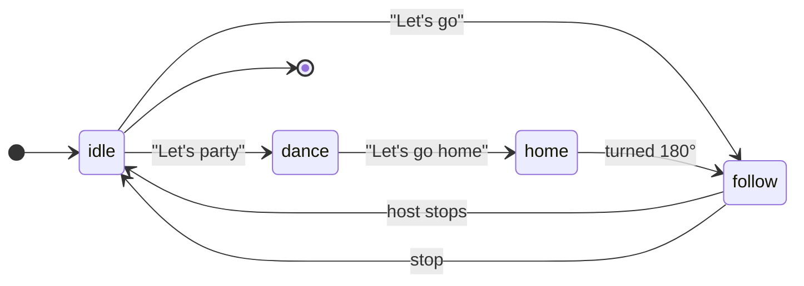
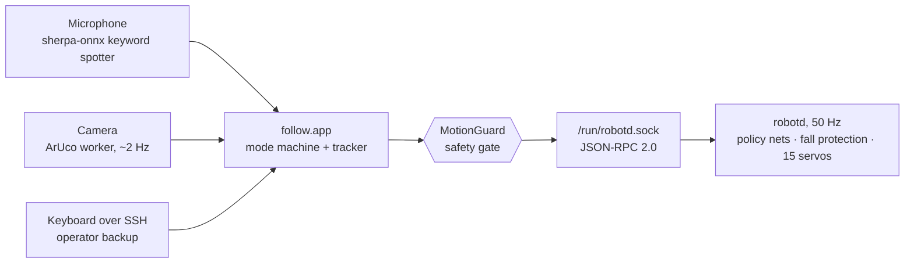

<div align="center">

```
                __
            ___( o)>    "Let's go!"
            \ <_. )
             `---'      M I C R O D U C K
            _/   \_
```

# Microduck

**Say "Let's go" — a biped robot duck follows you on stage, dances, and walks you home.**


</div>

---

A Python module for the [MHDuck Microduck](https://github.com/MHDuck/microduck) — a 14-joint biped duck on a
Radxa Zero 3W. It listens for a handful of English phrases, tracks an ArUco marker on the host's clothes, and
drives the duck through a three-act stage routine. Everything runs on the duck itself; no Wi-Fi is needed on stage.

> [!WARNING]
> This is a live experiment with a real robot and a show date. Things here are still being tried on the
> hardware, and some of them have only been run in simulation. Anything that moves the motors needs a
> person standing next to the duck.

## The show

| Act | The host says | The duck does | Operator backup key |
|:---:|---|---|:---:|
| **1** | **"Let's go, follow me!"** | Follows the host on stage, eyes on the marker | `f` |
| **2** | **"Let's party!"** | Dances on the spot: sway, nod, chatter, chirp (up to 30 s) | `d` |
| **3** | **"Let's go home"** | Turns 180° and follows the host off stage | `h` |



"Let's go" is context-aware: from standby it means *follow*, and from a dance it means *go home*. That way a
clipped "Let's go home" still does the right thing.

## How it works



The module is only ever a **client** of `robotd`. It sends intents over a socket and never touches motor,
fall-protection or policy code.

### The safety gate

Every motion command passes through `MotionGuard`, which refuses to move unless all of these hold:

| Check | Limit |
|---|---|
| Battery | walking stops at **7.6 V**; no stand-up at or below **7.5 V** |
| CPU temperature | below **90 °C** |
| Forward speed | **0.12 m/s** by default, never sideways |
| Robot state | fresh (under 0.5 s old), not fallen, not limp |
| IMU and servo bus | no stuck readings, no consecutive bus errors |
| On exit or target loss | `robot.stop` is always sent and acknowledged |

## Quick start

Run the offline tests anywhere. They talk to a fake `robotd` over socket pairs, so no robot is needed:

```sh
python3 -m unittest discover -s follow/tests -t .
```

On the duck:

```sh
bash follow/deploy.sh radxa@<duck-ip>       # copy to ~/microduck-follow, run the tests there
python3 -m follow.probe                     # read-only: would the gate allow motion right now?
python3 -m follow.app                       # dry run: prints decisions, moves nothing
python3 -m follow.stand                     # bring the duck up from "held" (asks for "yes")
bash follow/show.sh                         # show day: camera + voice + live motion
```

## Controls

<table>
<tr><th>Keyboard (letter + Enter)</th><th>Voice (English)</th></tr>
<tr><td valign="top">

| Key | Action |
|:---:|---|
| `f` | follow |
| `g` | gaze at the marker, head only |
| `d` | dance |
| `w` | greet |
| `h` | go home |
| `x` `u` `p` | sit, stand up, crouch |
| `1` | pick something up |
| `2` `3` `4` | roll, kick left, kick right (press twice) |
| `s` or just `Enter` | **stop** |
| `q` | quit, duck stays standing |

</td><td valign="top">

| Phrase | Action |
|---|---|
| "Let's go" | follow, or go home after a dance |
| "Follow me" | follow |
| "Let's go home" · "Go home" | go home |
| "Let's party" · "Shake it" | dance |
| "Look at me" | gaze |
| "Say hello" | greet |
| "Sit down" · "Get up" · "Lie down" | posture |
| "Stop" | stop |

</td></tr>
</table>

> [!TIP]
> Do not rely on a spoken "Stop" in a noisy room. The operator keeps a hand on `Enter`.

## Field notes

Measured on the real duck and in simulation so far:

| Finding | Detail |
|---|---|
| **A speed of 0.05 m/s means "stand"** | `robotd` picks the standing network at or below 0.05 m/s. At 0.08 the duck only steps in place. It walks at 0.12. |
| **Follow is slow** | The tracker walks in pulses, then stops to look. Simulated average ground speed is about 0.07 m/s. |
| **The voice model mattered more than the mic** | The same on-duck recording was missed by a zh-en model and caught by the English GigaSpeech model. |
| **Noise** | Four kinds of synthetic stage noise produced zero false triggers. "Follow me" survives noise best; a lone "Let's go" and "Stop" do not. |
| **`robot.stop` does not cancel a skill** | The app watches the policy `robotd` reports instead of its own mode. |
| **`robot.pose` has no deadman** | Velocity intents time out after 500 ms; poses do not, so a pose is always released explicitly. |
| **Heat** | Standing still with the media daemon running already reads 84–85 °C. |

The full story, with charts, is in the [devlog page](docs/devlog/microduck-devlog.html).

## Repository map

| Path | What it is |
|---|---|
| [`follow/`](follow/) | The module. Start with [`follow/README.md`](follow/README.md). |
| [`follow/tests/`](follow/tests/) | 278 offline tests, including a full-show rehearsal and a step-by-step comparison against the upstream tracker. |
| [`docs/show-runbook.md`](docs/show-runbook.md) | One-page operator runbook for show day. |
| [`docs/stage-demo.md`](docs/stage-demo.md) | Stage requirements, risks and schedule. |
| [`docs/codebase-map.md`](docs/codebase-map.md) | Notes on the upstream code base and its IPC API. |
| [`CLAUDE.md`](CLAUDE.md) | Working rules for the AI pair programmer on this project, safety rules included. |

Most documents are written in Traditional Chinese.

## Roadmap

- [x] `robotd` client, safety gate, read-only probe
- [x] Tracker, odometry turns, greeting, dance, posture and skills
- [x] English keyword spotting and a noise test
- [x] First stand-up, walk and sit on the real duck
- [ ] Head-only gaze and a first live follow
- [ ] Dance stability on the real duck
- [ ] Voice test with the real host, on the duck
- [ ] Ten-minute thermal run with camera and voice
- [ ] Full dress rehearsal
- [ ] Show day: **2026-12-03**

## Credits and license

Built on the [MHDuck Microduck](https://github.com/MHDuck/microduck) platform. Parts of this module are Python
ports of upstream code; see [NOTICE](NOTICE). The upstream sources are not included here.

Licensed under [Apache-2.0](LICENSE).

<div align="center"><sub>quack.</sub></div>
