<div align="center">


# MICRODUCK

**Stage Companion Robot** - voice-driven follow, dance and go-home for a biped robot duck

_Say "Let's go."_

<br>

[](https://github.com/charles-cs-yan/microduck/actions/workflows/tests.yml)


</div>

<br>

<div align="center">
  
</div>

<br>

## What this is

A Python module for the [MHDuck Microduck](https://github.com/MHDuck/microduck), a 14-joint biped robot duck
running on a Radxa Zero 3W. It listens for a few English phrases and walks the duck through a three-act stage
routine: on stage, a dance, and off stage. The duck's own microphone feeds a speech recogniser on the
operator's laptop; control runs on the duck and never bypasses the safety gate.

What sets it apart is the safety gate: every motion request passes through checks on battery, temperature,
IMU and servo health, and the module stops the duck whenever it loses its target or exits.

> This is a live experiment with a real robot and a show date (2026-12-03). Several parts have so far only
> been run in simulation. Anything that moves the motors needs a person standing next to the duck.

<br>

## The show

| Act | The host says | The duck does | Backup key |
|:---:|---|---|:---:|
| 1 | **"Let's go!"** | Walks straight 2 m on stage | `f` |
| 2 | **"Let's party!"** | Dances on the spot: sway, nod, chatter, chirp, up to 30 s | `d` |
| 3 | **"Let's go home"** | Turns 180° and walks straight 2 m off stage | `h` |

<div align="center">
  
</div>

**Show mode (since 2026-11-25): scripted.** Marker following was unreliable in rehearsal, so the show
runs without the camera: "Let's go" walks straight 2 m on stage, "Let's go home" turns 180° and walks
straight back. Speech is recognised on the operator's laptop from the duck's microphone (the duck's own
keyword spotter missed too much natural speech). One command starts both:
`powershell -File follow\start_show.ps1`. Marker following remains available with `-Camera`.

"Let's go" depends on context: before the duck is on stage it means walk on, once it is on stage it means
go home. A clipped "Let's go home" therefore still does the right thing.

The matcher also tolerates near-misses: "lass party", "say hallo" and "folow me" still land, while three
minutes of the host's real interview speech triggered nothing.

<br>

## Field notes

Measured on the real duck and in simulation.

> Below **0.05 m/s** the duck does not walk at all: `robotd` picks its standing network. At 0.08 it steps in
> place. It walks at 0.12.
>
> The tracker walks in pulses and stops to look, so the simulated average is about **0.07 m/s**.
>
> On the same 16 guided recordings, keyword spotting on the duck caught 7 (GigaSpeech) and 4 (zh-en); a
> streaming recogniser on the laptop caught all 16. The model mattered more than the microphone.

| Finding | Detail |
|---|---|
| Noise | Four kinds of synthetic stage noise, 60 s each, produced zero false triggers. "Follow me" holds up best; a lone "Let's go" and "Stop" do not. |
| `robot.stop` does not cancel a skill | The app watches the policy `robotd` reports instead of its own mode. |
| `robot.pose` has no deadman | Velocity intents time out after 500 ms; poses do not, so a pose is always released explicitly. |
| Heat | Standing still with the media daemon running already reads 84–85 °C, against a 90 °C gate. |
| Battery | The charger has so far topped out at 7.9 V of a nominal 8.4 V. Walking stops at 7.0 V. |
| Sit to stand | The fall detector re-arms the instant a rise ends, so a wobble can read as a fall and the legs go limp for a moment. |

<br>

## Controls

**Keyboard** (letter + Enter)

| Key | Action |
|:---:|---|
| `f` | follow |
| `g` | gaze at the marker, head only |
| `d` | dance |
| `w` | greet |
| `h` | go home |
| `k` | walk straight 2 m |
| `x` `u` `p` | sit, stand up, crouch |
| `1` | pick something up |
| `2` `3` `4` | roll, kick left, kick right (press twice) |
| `s` or `Enter` | **stop** |
| `q` | quit, the duck stays standing |

**Voice** (English, within a metre of the duck)

| Phrase | Action |
|---|---|
| "Let's go" | walk on stage, or go home once on stage |
| "Follow me" | walk on stage |
| "Let's go home" · "Go home" | go home |
| "Let's party" · "Shake it" | dance |
| "Look at me" | gaze |
| "Say hello" | greet |
| "Sit down" · "Get up" · "Lie down" | posture |
| "Stop" | stop |

Do not rely on a spoken "Stop" in a noisy room. The operator keeps a hand on `Enter`.

<br>

## Quick start

```bash
python3 -m unittest discover -s follow/tests -t .   # 306 offline tests, no robot needed
```

The tests talk to a fake `robotd` over socket pairs. Tests that need OpenCV or sherpa-onnx skip themselves
when those packages are missing.

On the duck:

```bash
bash follow/deploy.sh radxa@<duck-ip>   # copy to ~/microduck-follow and run the tests there
python3 -m follow.probe                 # read-only: would the gate allow motion right now?
python3 -m follow.app                   # dry run: prints decisions, moves nothing
python3 -m follow.stand                 # bring the duck up from "held" (asks for "yes")
bash follow/show.sh --scripted          # live motion, straight-line show, keyboard
```

On show day, from the operator's laptop (Windows, recogniser in WSL):

```powershell
powershell -ExecutionPolicy Bypass -File follow\start_show.ps1   # options: -WalkM 1.5, -NoEars, -Camera
```

It opens a "DUCK EARS" window for speech, which waits for the show and reconnects on its own, and runs
`show.sh --scripted` on the duck. The operator types `yes` before the duck may move. `-Camera` brings back
the marker-following show, which stops the media daemon and needs sudo.

<br>

## Architecture

<div align="center">
  
</div>

The module is only ever a **client** of `robotd`. It sends intents over the socket and never touches motor,
fall-protection or policy code.

```
follow/
├─ app.py            mode machine: idle / gaze / follow / home / greet / dance / sit / crouch / skill
├─ motion.py         MotionGuard: rate-limited intents, health polling, guaranteed stop
├─ safety.py         limits and gate checks
├─ tracker.py        marker follow in pulses (ported from upstream vision_follow)
├─ turning.py        closed-loop turns on odometry
├─ greet.py          keyframed routines: greeting and dance
├─ posture.py        sit, stand, crouch, skills
├─ robotd_client.py  JSON-RPC client for /run/robotd.sock
├─ voice/            laptop recogniser bridge, intent matching, recording and scoring tools
├─ vision/           ArUco worker, camera check, auto-exposure, browser relay
├─ show.sh           show launcher on the duck
├─ start_show.ps1    one-command show launcher on the laptop
└─ tests/            306 tests, a full-show rehearsal, a step-by-step diff against upstream
```

<details>
<summary><b>Repository map</b></summary>
<br>

| Path | What it is |
|---|---|
| [`follow/README.md`](follow/README.md) | Module details, camera and voice setup |
| [`docs/show-runbook.md`](docs/show-runbook.md) | One-page operator runbook for show day |
| [`docs/stage-demo.md`](docs/stage-demo.md) | Stage requirements, risks and schedule |
| [`docs/codebase-map.md`](docs/codebase-map.md) | Notes on the upstream code base and its IPC API |
| [`CHANGELOG.md`](CHANGELOG.md) | What changed, day by day |
| [`CLAUDE.md`](CLAUDE.md) | Working rules for the AI pair programmer, safety rules included |

Most documents are in Traditional Chinese.

</details>

<br>

## Roadmap

- [x] `robotd` client, safety gate, read-only probe
- [x] Tracker, odometry turns, greeting, dance, posture and skills
- [x] English keyword spotting and a synthetic noise test
- [x] Laptop speech recognition from the duck's microphone, fuzzy phrase matching
- [x] First stand-up, walk and sit on the real duck
- [x] Voice-triggered greet and dance on the real duck
- [x] Scripted straight-line show, no camera
- [ ] Straight walk and 180° turn measured on the real duck
- [ ] Steadier sit-to-stand
- [ ] Rehearsal with the host on 2026-11-26
- [ ] Ten-minute thermal run with camera and voice
- [ ] Full dress rehearsal, then show day on 2026-12-03

<br>

## License

[Apache-2.0](LICENSE) © Charles Yan

Parts of `follow/` are Python ports of code from the upstream [Microduck](https://github.com/MHDuck/microduck)
project, also Apache-2.0; see [NOTICE](NOTICE). The upstream sources are not included here.
