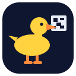
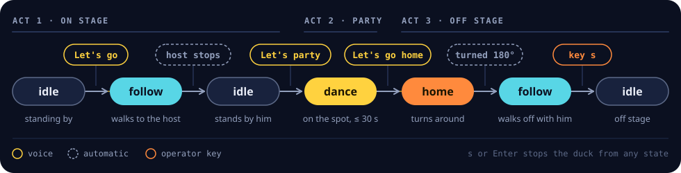
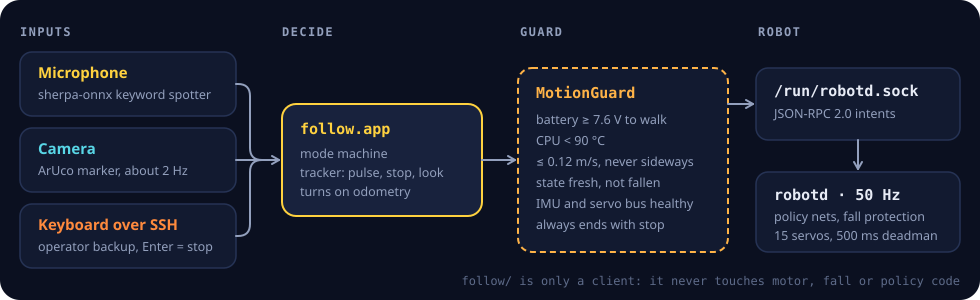

<div align="center">



# MICRODUCK

**Stage Companion Robot** - voice-driven follow, dance and go-home for a biped robot duck

_Say "Let's go."_

<br>

[](https://github.com/charles-cs-yan/microduck/actions/workflows/tests.yml)


</div>

<br>

<div align="center">
  
</div>

<br>

## What this is

A Python module for the [MHDuck Microduck](https://github.com/MHDuck/microduck), a 14-joint biped robot duck
running on a Radxa Zero 3W. It listens for a few English phrases, tracks an ArUco marker on the host's
clothes, and walks the duck through a three-act stage routine. Recognition and control both run on the duck,
so the show does not depend on the venue's Wi-Fi.

What sets it apart is the safety gate: every motion request passes through checks on battery, temperature,
IMU and servo health, and the module stops the duck whenever it loses its target or exits.

> This is a live experiment with a real robot and a show date (2026-12-03). Several parts have so far only
> been run in simulation. Anything that moves the motors needs a person standing next to the duck.

<br>

## The show

| Act | The host says | The duck does | Backup key |
|:---:|---|---|:---:|
| 1 | **"Let's go, follow me!"** | Follows the host on stage, eyes on the marker | `f` |
| 2 | **"Let's party!"** | Dances on the spot: sway, nod, chatter, chirp, up to 30 s | `d` |
| 3 | **"Let's go home"** | Turns 180° and follows the host off stage | `h` |

<div align="center">
  
</div>

"Let's go" depends on context: from standby it means follow, after a dance it means go home. A clipped
"Let's go home" therefore still does the right thing.

<br>

## Field notes

Measured on the real duck and in simulation.

> Below **0.05 m/s** the duck does not walk at all: `robotd` picks its standing network. At 0.08 it steps in
> place. It walks at 0.12.
>
> The tracker walks in pulses and stops to look, so the simulated average is about **0.07 m/s**.
>
> The same on-duck recording was missed by a zh-en model and caught by the English GigaSpeech model. The
> model mattered more than the microphone.

| Finding | Detail |
|---|---|
| Noise | Four kinds of synthetic stage noise, 60 s each, produced zero false triggers. "Follow me" holds up best; a lone "Let's go" and "Stop" do not. |
| `robot.stop` does not cancel a skill | The app watches the policy `robotd` reports instead of its own mode. |
| `robot.pose` has no deadman | Velocity intents time out after 500 ms; poses do not, so a pose is always released explicitly. |
| Heat | Standing still with the media daemon running already reads 84–85 °C, against a 90 °C gate. |
| Battery | The charger has so far topped out at 7.77 V of a nominal 8.4 V. |

<br>

## Controls

<table>
<tr><th width="50%">Keyboard (letter + Enter)</th><th width="50%">Voice (English)</th></tr>
<tr><td valign="top">

| Key | Action |
|:---:|---|
| `f` | follow |
| `g` | gaze at the marker, head only |
| `d` | dance |
| `w` | greet |
| `h` | go home |
| `x` `u` `p` | sit, stand up, crouch |
| `1` | pick something up |
| `2` `3` `4` | roll, kick left, kick right (press twice) |
| `s` or `Enter` | **stop** |
| `q` | quit, the duck stays standing |

</td><td valign="top">

| Phrase | Action |
|---|---|
| "Let's go" | follow, or go home after a dance |
| "Follow me" | follow |
| "Let's go home" · "Go home" | go home |
| "Let's party" · "Shake it" | dance |
| "Look at me" | gaze |
| "Say hello" | greet |
| "Sit down" · "Get up" · "Lie down" | posture |
| "Stop" | stop |

</td></tr>
</table>

Do not rely on a spoken "Stop" in a noisy room. The operator keeps a hand on `Enter`.

<br>

## Quick start

```bash
python3 -m unittest discover -s follow/tests -t .   # 278 offline tests, no robot needed
```

The tests talk to a fake `robotd` over socket pairs. Tests that need OpenCV or sherpa-onnx skip themselves
when those packages are missing.

On the duck:

```bash
bash follow/deploy.sh radxa@<duck-ip>   # copy to ~/microduck-follow and run the tests there
python3 -m follow.probe                 # read-only: would the gate allow motion right now?
python3 -m follow.app                   # dry run: prints decisions, moves nothing
python3 -m follow.stand                 # bring the duck up from "held" (asks for "yes")
bash follow/show.sh                     # show day: camera + voice + live motion
```

`show.sh` asks for the sudo password once, stops the media daemon so it can read the camera directly, and
restores it on any exit. It asks the operator to type `yes` before the duck may move.

<br>

## Architecture

<div align="center">
  
</div>

The module is only ever a **client** of `robotd`. It sends intents over the socket and never touches motor,
fall-protection or policy code.

| Gate check | Limit |
|---|---|
| Battery | walking stops at 7.6 V; no stand-up at or below 7.5 V |
| CPU temperature | below 90 °C |
| Forward speed | 0.12 m/s by default, never sideways |
| Robot state | under 0.5 s old, not fallen, not limp |
| IMU and servo bus | no stuck readings, no consecutive bus errors |
| Exit or target loss | `robot.stop` is always sent and acknowledged |

```
follow/
├─ app.py            mode machine: idle / gaze / follow / home / greet / dance / sit / crouch / skill
├─ motion.py         MotionGuard: rate-limited intents, health polling, guaranteed stop
├─ safety.py         limits and gate checks
├─ tracker.py        marker follow in pulses (ported from upstream vision_follow)
├─ turning.py        closed-loop turns on odometry
├─ greet.py          keyframed routines: greeting and dance
├─ posture.py        sit, stand, crouch, skills
├─ robotd_client.py  JSON-RPC client for /run/robotd.sock
├─ voice/            keyword lists, listener, model fetch, mic check
├─ vision/           ArUco worker, camera check, auto-exposure, browser relay
├─ show.sh           one-command show launcher
└─ tests/            278 tests, a full-show rehearsal, a step-by-step diff against upstream
```

<details>
<summary><b>Repository map</b></summary>
<br>

| Path | What it is |
|---|---|
| [`follow/README.md`](follow/README.md) | Module details, camera and voice setup |
| [`docs/show-runbook.md`](docs/show-runbook.md) | One-page operator runbook for show day |
| [`docs/stage-demo.md`](docs/stage-demo.md) | Stage requirements, risks and schedule |
| [`docs/codebase-map.md`](docs/codebase-map.md) | Notes on the upstream code base and its IPC API |
| [`CHANGELOG.md`](CHANGELOG.md) | What changed, day by day |
| [`CLAUDE.md`](CLAUDE.md) | Working rules for the AI pair programmer, safety rules included |

Most documents are in Traditional Chinese.

</details>

<br>

## Roadmap

- [x] `robotd` client, safety gate, read-only probe
- [x] Tracker, odometry turns, greeting, dance, posture and skills
- [x] English keyword spotting and a synthetic noise test
- [x] First stand-up, walk and sit on the real duck
- [ ] Head-only gaze and a first live follow
- [ ] Dance stability on the real duck
- [ ] Voice test with the real host, on the duck
- [ ] Ten-minute thermal run with camera and voice
- [ ] Full dress rehearsal, then show day on 2026-12-03

<br>

## License

[Apache-2.0](LICENSE) © Charles Yan

Parts of `follow/` are Python ports of code from the upstream [Microduck](https://github.com/MHDuck/microduck)
project, also Apache-2.0; see [NOTICE](NOTICE). The upstream sources are not included here.
